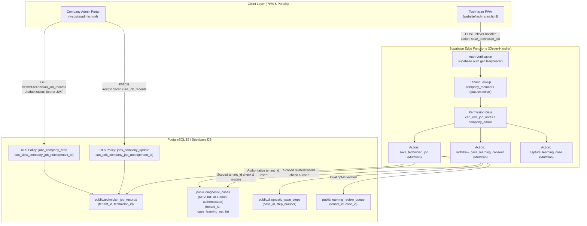

# PoolDocAI Application Tenant Isolation Contracts: Diagnostic Cases & Technician Job Records

**Document Version:** 1.1.0  
**Date:** 2026-10-25  
**Component:** Security Architecture & Application-Level Tenant Isolation  
**Related Tasks:** TASK-008 Part-1, TASK-009 Part-1 (Verification & Evidence Accuracy)  
**Target Projects:**
- Staging: `rzkgmvyyeclrpomrlyft`
- Production: `owfeebydlyacssqpnmkq` (STRICTLY READ-ONLY / UNTOUCHED)

---

## 1. Executive Summary & Evidence Scope

This contract review inventories and analyzes the application-level tenant isolation controls governing `diagnostic_cases` and `technician_job_records` within PoolDocAI.

A critical security principle established in TASK-008 and reinforced in TASK-009 is:
> **Schema-level direct table access rejection (`REVOKE ALL` returning HTTP 401/403) confirms a baseline deny-by-design policy, but does NOT constitute positive application-level tenant isolation.**

### Scope of Evidence in Part-1 (Code-Only Verification):
The local and CI evidence produced in Part-1 represents **extracted-handler-block execution paired with simulated authorization and in-memory RLS filtering**. It exercises the exact server-side control blocks extracted from production source files (`clever-handler/index.ts`). However, because it runs in a simulated Node environment without live GoTrue or PostgREST services:
1. It validates application code logic, anti-spoofing guards, and input validation.
2. It does **not** substitute for live staging verification against the real Supabase GoTrue authentication engine or PostgreSQL RLS policies.
3. Live controls `4A-APP`, `4B-APP`, `4D-APP`, and `4E-APP` on project `rzkgmvyyeclrpomrlyft` remain strictly marked `[LIVE NOT RUN]` until owner-authorized staging execution (Part-2) is completed.

---

## 2. End-to-End Architectural Flows



---

## 3. Contract Trace: `technician_job_records`

### 3.1 Direct PostgREST Table Interface (Read & Update)
- **Primary Schema Definition:** [`supabase/migrations/202610210002_technician_job_records.sql`](../../supabase/migrations/202610210002_technician_job_records.sql#L2-L33)
- **Tenant Columns & Foreign Keys:** [`supabase/migrations/202610210003_company_admin_portal.sql#L42-L52`](../../supabase/migrations/202610210003_company_admin_portal.sql#L42-L52)
  - `technician_id uuid references auth.users(id) on delete set null`
  - `tenant_id uuid references public.companies(id) on delete cascade`
- **Granular Permissions & RLS Policies:** [`supabase/migrations/202610210009_company_member_permissions_management.sql#L117-L127`](../../supabase/migrations/202610210009_company_member_permissions_management.sql#L117-L127)
  - `REVOKE ALL ON public.technician_job_records FROM anon;`
  - `GRANT SELECT, UPDATE ON public.technician_job_records TO authenticated;`
  - **Direct INSERT is deliberately REVOKED from `authenticated` and `anon`.** Browser clients cannot directly insert job rows; all job creation must flow through the Edge Function handler.
  - **SELECT Policy (`jobs_company_read`):**
    ```sql
    CREATE POLICY jobs_company_read ON public.technician_job_records
    FOR SELECT TO authenticated
    USING (tenant_id IS NOT NULL AND public.can_view_company_job_notes(tenant_id));
    ```
    Where `can_view_company_job_notes(p_company_id)` verifies that `auth.uid()` has an `active` membership in an `active` or `pilot` company with role `company_admin` or `can_view_job_notes = true` ([`migration 202610210009#L72-L80`](../../supabase/migrations/202610210009_company_member_permissions_management.sql#L72-L80)).
  - **UPDATE Policy (`jobs_company_update`):**
    ```sql
    CREATE POLICY jobs_company_update ON public.technician_job_records
    FOR UPDATE TO authenticated
    USING (tenant_id IS NOT NULL AND public.can_edit_company_job_notes(tenant_id))
    WITH CHECK (tenant_id IS NOT NULL AND public.can_edit_company_job_notes(tenant_id));
    ```
- **Consumer Clients:**
  - Company Admin Portal: [`website/admin.html#L315`](../../website/admin.html#L315) queries `client.from('technician_job_records').select('*').eq('tenant_id', c.id)`.

### 3.2 Application Create / Save Endpoint (`save_technician_job`)
- **Location:** [`supabase/functions/clever-handler/index.ts#L2522`](../../supabase/functions/clever-handler/index.ts#L2522) and [`#L2796-L2998`](../../supabase/functions/clever-handler/index.ts#L2796-L2998).
- **Triggering Client:** Technician PWA offline outbox sync in [`website/technician.html#L236`](../../website/technician.html#L236) and inline field notes in [`website/app.html#L5393`](../../website/app.html#L5393).
- **Authentication & Identity Derivation:**
  1. Requests must supply `Authorization: Bearer <jwt>` and body flag `authenticatedApp: true`.
  2. The server verifies token authenticity via `supabase.auth.getUser(bearer)` ([`index.ts#L1673`](../../supabase/functions/clever-handler/index.ts#L1673)).
  3. Checks temporary access expiry/revocation in `temporary_access_grants` ([`index.ts#L1677-L1679`](../../supabase/functions/clever-handler/index.ts#L1677-L1679)).
  4. Authoritatively resolves tenant membership:
     ```typescript
     const { data: memberships } = await supabase.from("company_members")
       .select("company_id,role,can_view_job_notes,can_edit_job_notes,can_upload_documents,can_review_documents,companies(status,seat_limit,industry_key)")
       .eq("user_id", authenticatedUserId).eq("status", "active");
     ```
     Derives `authenticatedCompanyId`, `authenticatedRole`, and granular permissions ([`index.ts#L1688-L1698`](../../supabase/functions/clever-handler/index.ts#L1688-L1698)).
- **Permission & Anti-Spoofing Checks:**
  1. **Seat Permission:**
     `if (!authenticatedCompanyId || !authenticatedUserId || !(authenticatedRole === "company_admin" || authenticatedPermissions?.canEditJobNotes === true)) return 403 JOB_NOTE_EDIT_PERMISSION_REQUIRED;` ([`index.ts#L2797`](../../supabase/functions/clever-handler/index.ts#L2797)).
  2. **Client Company ID Spoofing Guard:**
     `if (body.companyId && textValue(body.companyId, 80) !== authenticatedCompanyId) return 403 TENANT_MISMATCH;` ([`index.ts#L2798-L2800`](../../supabase/functions/clever-handler/index.ts#L2798-L2800)).
  3. **Related Case Boundary Check:**
     If `body.relatedCaseId` is provided, verifies that it exists AND belongs to the authenticated company:
     ```typescript
     const { data: existingCase, error: caseLookupError } = await supabase
       .from("diagnostic_cases")
       .select("id, tenant_id")
       .eq("id", rawRelatedCaseId)
       .eq("tenant_id", authenticatedCompanyId)
       .maybeSingle();
     if (caseLookupError || !existingCase) {
       return jsonResponse({ error: "The referenced diagnostic case belongs to a different company workspace or was not found.", code: "TENANT_MISMATCH" }, 403);
     }
     ```
     ([`index.ts#L2822-L2830`](../../supabase/functions/clever-handler/index.ts#L2822-L2830)).
- **Database Write & Idempotency:**
  1. Inserts into `technician_job_records` with authoritatively bound columns:
     `tenant_id: authenticatedCompanyId`, `technician_id: authenticatedUserId` ([`index.ts#L2836-L2837`](../../supabase/functions/clever-handler/index.ts#L2836-L2837)).
  2. Handles offline idempotency via `client_job_id` and unique index `technician_jobs_client_idempotency_idx` ([`migration 202610210012#L152`](../../supabase/migrations/202610210012_invites_billing_usage_vector_industry.sql#L152)). Replays existing record if identical or returns HTTP 409 `JOB_SYNC_CONFLICT` if payload differs.
  3. Publishes durable company notification via `pooldocai_publish_company_notification` scoped to `authenticatedCompanyId` ([`index.ts#L2879-L2891`](../../supabase/functions/clever-handler/index.ts#L2879-L2891)).

---

## 4. Contract Trace: `diagnostic_cases`

### 4.1 Direct PostgREST Table Interface (Deny-by-Design)
- **Primary Schema Definition:** [`supabase/migrations/202610210001_learning_loop_privacy.sql#L6-L65`](../../supabase/migrations/202610210001_learning_loop_privacy.sql#L6-L65)
- **Security Posture:**
  ```sql
  REVOKE ALL ON public.diagnostic_cases FROM anon, authenticated;
  GRANT ALL ON public.diagnostic_cases TO service_role;
  ```
- **Operational Impact:**
  - `diagnostic_cases` contains internal diagnostic session traces, normalized equipment models, and learning consent flags.
  - Direct browser PostgREST queries return HTTP 401 or 403 ("permission denied for table diagnostic_cases").
  - This deny-by-design policy is strictly expected. All legitimate access must proceed through authenticated server actions.

### 4.2 Application Create & Link (`save_technician_job` & `capture_learning_case`)
- **`save_technician_job` Case Creation (Mutation):**
  - Automatically creates a corresponding private diagnostic case in `diagnostic_cases`:
    ```typescript
    const { data: learningCase } = await supabase.from("diagnostic_cases").insert({
      tenant_id: authenticatedCompanyId,
      case_status: row.case_status,
      equipment_category: row.equipment_category,
      manufacturer_normalized: row.manufacturer_normalized,
      model_normalized: row.model_normalized,
      symptom_redacted: caseIssue,
      resolution_summary_redacted: caseResolution || null,
      source_ids: [data.id],
      technician_verified: row.technician_verified,
      approved_for_learning: false,
      case_learning_opt_in: effectiveCaseOptIn,
      learning_terms_version: authoritativeTermsVersion,
      consent_origin: effectiveCaseOptIn ? "verified_server_terms_acceptance" : "denied_or_unconsented",
      contributor_accepted_at: authoritativeAcceptedAt,
      contributor_user_id: effectiveCaseOptIn ? authenticatedUserId : null
    }).select("id").single();
    ```
    ([`index.ts#L2931-L2941`](../../supabase/functions/clever-handler/index.ts#L2931-L2941)).
  - Inserts step into `diagnostic_case_steps` referencing the case ([`index.ts#L2963-L2980`](../../supabase/functions/clever-handler/index.ts#L2963-L2980)).
  - Links `technician_job_records.related_case_id` to `learningCase.id` ([`index.ts#L2990`](../../supabase/functions/clever-handler/index.ts#L2990)).

- **Dual-Opt-In Consent Validation:**
  - Contributor Consent: Edge Function authoritatively queries `pooldocai_legal_acceptances` table for `user_id = authenticatedUserId AND company_id = authenticatedCompanyId` and terms version matching `^2026-10` ([`index.ts#L2907-L2920`](../../supabase/functions/clever-handler/index.ts#L2907-L2920)).
  - Company Consent: Checks `companies.diagnostic_learning_opt_in` ([`index.ts#L2924-L2925`](../../supabase/functions/clever-handler/index.ts#L2924-L2925)).
  - Queueing: Row enters `learning_review_queue` ONLY if technician verified repair, contributor consented, AND governing company opted in ([`index.ts#L2981-L2989`](../../supabase/functions/clever-handler/index.ts#L2981-L2989)).

- **`capture_learning_case` Action (Mutation):**
  - Route: `POST /clever-handler` with `action: "capture_learning_case"` ([`index.ts#L3142-L3200`](../../supabase/functions/clever-handler/index.ts#L3142-L3200)).
  - Strict tenant scoping: Inserts row with `tenant_id: authenticatedCompanyId`.
  - Contributor terms verified against `pooldocai_legal_acceptances`.

### 4.3 Application Consent Mutation (`withdraw_case_learning_consent`)
- **Location:** [`supabase/functions/clever-handler/index.ts#L3205-L3238`](../../supabase/functions/clever-handler/index.ts#L3205-L3238).
- **Trigger:** Company technician or admin explicitly revoking shared-learning consent for a previously logged case.
- **Clarification:** This action is a **mutating consent update operation**, NOT a read or retrieval endpoint.
- **Tenant Isolation Enforcement:**
  ```typescript
  const { data: caseRecord, error: caseErr } = await supabase
    .from("diagnostic_cases")
    .select("id,tenant_id,case_learning_opt_in")
    .eq("id", targetCaseId)
    .maybeSingle();

  if (caseErr || !caseRecord) {
    return jsonResponse({ error: "Diagnostic case not found.", code: "CASE_NOT_FOUND" }, 404);
  }

  if (!isPlatformOwner && caseRecord.tenant_id !== authenticatedCompanyId) {
    return jsonResponse({ error: "You cannot modify another company's case.", code: "TENANT_MISMATCH" }, 403);
  }
  ```
- **Atomicity & Cleanup:**
  1. Updates `diagnostic_cases` setting `case_learning_opt_in = false` and `approved_for_learning = false`.
  2. Deletes any published knowledge in `shared_learning_knowledge` (`source_case_id = targetCaseId`).
  3. Marks pending queue items as `rejected` in `learning_review_queue`.
  4. Leaves private internal diagnostic case row intact for company workspace use.

### 4.4 Architectural Observation: Diagnostic Case Read / Retrieval Contract Gap
- **Finding:** Currently, there is **no dedicated authenticated endpoint or RPC** (e.g., `get_diagnostic_case` or `list_company_diagnostic_cases`) for company technicians or administrators to directly query and retrieve raw `diagnostic_cases` rows.
- **Current Retrieval Mechanism:**
  1. Technicians interact with cases indirectly via linked `technician_job_records` (`related_case_id`), which are readable via PostgREST RLS `jobs_company_read`.
  2. Diagnostic steps and review candidates are accessed exclusively by platform owners through administrative review queues (`list_learning_review_queue`).
- **Recommendation:** If a future product requirement calls for direct viewing of diagnostic session transcripts by tenant technicians, a minimum production-grade read endpoint or tenant-scoped PostgreSQL view must be designed, documented, and submitted for independent security review prior to implementation.

---

## 5. Security Evaluation & Service-Role Guardrails

Because Edge Functions utilize a Supabase `service_role` client to manage backend workflows across tables where direct browser writes are revoked, the Edge Function acts as the authoritative security boundary.

| Risk Scenario | Prevention Mechanism in Code | Local Verification Status |
| :--- | :--- | :--- |
| **Client supplies foreign `companyId` in JSON payload** | Explicitly compared against `authenticatedCompanyId` resolved from GoTrue JWT. Mismatch triggers HTTP 403 `TENANT_MISMATCH` ([`index.ts#L2798`](../../supabase/functions/clever-handler/index.ts#L2798)). | Verified in handler simulation suite |
| **Client references foreign `relatedCaseId`** | Database lookup queries `.eq("id", rawRelatedCaseId).eq("tenant_id", authenticatedCompanyId)`. Foreign case returns HTTP 403 `TENANT_MISMATCH` ([`index.ts#L2822-L2830`](../../supabase/functions/clever-handler/index.ts#L2822-L2830)). | Verified in handler simulation suite |
| **Client attempts to withdraw consent on foreign case** | Checks `caseRecord.tenant_id !== authenticatedCompanyId`. Returns HTTP 403 `TENANT_MISMATCH` ([`index.ts#L3217-L3219`](../../supabase/functions/clever-handler/index.ts#L3217-L3219)). | Verified in handler simulation suite |
| **Unauthenticated / Anonymous request** | Early rejection: `if (body.authenticatedApp !== true \|\| !authenticatedCompanyId \|\| !authenticatedUserId) return 401 AUTH_REQUIRED` ([`index.ts#L2522`](../../supabase/functions/clever-handler/index.ts#L2522)). | Verified in handler simulation suite |
| **Revoked or Inactive Member** | Query to `company_members` filters `.eq("status", "active")`. Returns HTTP 401 or 500 `MEMBERSHIP_LOOKUP_FAILED` ([`index.ts#L1682`](../../supabase/functions/clever-handler/index.ts#L1682)). | Verified in handler simulation suite |
| **Seat lacks `canEditJobNotes` permission** | Explicit role & permission evaluation: `!(authenticatedRole === "company_admin" \|\| authenticatedPermissions?.canEditJobNotes === true)`. Returns HTTP 403 `JOB_NOTE_EDIT_PERMISSION_REQUIRED` ([`index.ts#L2797`](../../supabase/functions/clever-handler/index.ts#L2797)). | Verified in handler simulation suite |
| **Direct PostgREST table tampering** | `REVOKE ALL` on `diagnostic_cases`; `GRANT SELECT, UPDATE` on `technician_job_records` bounded by RLS `can_view_company_job_notes` and `can_edit_company_job_notes`. Direct INSERT revoked. | Verified in CI local Postgres RLS tests |

---

## 6. Audit & Test Matrix for 4A, 4B, 4D, 4E

| Control ID | Operation & Path | Tenant Context | Expected Result | Verification Tier |
| :--- | :--- | :--- | :--- | :--- |
| **4A-POS-APP** | `save_technician_job` creates case / `withdraw_case_learning_consent` | Company A Tech in Tenant A | 200 OK; record created/mutated in Tenant A | Simulated (Local CI) / NOT RUN (Staging) |
| **4A-NEG-CROSS** | `withdraw_case_learning_consent` targeting Tenant A case | Company B Tech with Tenant B JWT | 403 TENANT_MISMATCH | Simulated (Local CI) / NOT RUN (Staging) |
| **4A-NEG-UUID** | `save_technician_job` with `relatedCaseId` of Tenant A case | Company B Tech with Tenant B JWT | 403 TENANT_MISMATCH | Simulated (Local CI) / NOT RUN (Staging) |
| **4A-SCHEMA** | Direct `GET /rest/v1/diagnostic_cases` | Company A Tech with Tenant A JWT | 401/403 Deny-by-design | Verified in local Postgres / Staging Live Preflight |
| **4B-POS-APP** | `save_technician_job` creates case / `withdraw_case_learning_consent` | Company B Tech in Tenant B | 200 OK; record created/mutated in Tenant B | Simulated (Local CI) / NOT RUN (Staging) |
| **4B-NEG-CROSS** | `withdraw_case_learning_consent` targeting Tenant B case | Company A Tech with Tenant A JWT | 403 TENANT_MISMATCH | Simulated (Local CI) / NOT RUN (Staging) |
| **4B-NEG-UUID** | `save_technician_job` with `relatedCaseId` of Tenant B case | Company A Tech with Tenant A JWT | 403 TENANT_MISMATCH | Simulated (Local CI) / NOT RUN (Staging) |
| **4B-SCHEMA** | Direct `GET /rest/v1/diagnostic_cases` | Company B Tech with Tenant B JWT | 401/403 Deny-by-design | Verified in local Postgres / Staging Live Preflight |
| **4D-POS-APP-SAVE** | `save_technician_job` (Edge Function) | Company A Tech in Tenant A | 200 OK; job saved in Tenant A | Simulated (Local CI) / NOT RUN (Staging) |
| **4D-POS-APP-READ** | PostgREST `SELECT * FROM technician_job_records` | Company A Tech in Tenant A | 200 OK; returns Tenant A jobs | Simulated (Local CI) / Staging SQL Validated |
| **4D-NEG-CROSS-READ**| PostgREST `SELECT * WHERE tenant_id = Tenant B` | Company A Tech in Tenant A | 200 OK with empty `[]` / 0 rows | Simulated (Local CI) / Staging SQL Validated |
| **4D-NEG-CROSS-UPDATE**| PostgREST `PATCH WHERE id = Tenant B Job` | Company A Tech in Tenant A | 0 rows affected / 403 Forbidden | Simulated (Local CI) / Staging SQL Validated |
| **4D-NEG-SPOOF** | `save_technician_job` with `companyId = Tenant B` | Company A Tech in Tenant A | 403 TENANT_MISMATCH | Simulated (Local CI) / NOT RUN (Staging) |
| **4D-NEG-NO-PERM**| `save_technician_job` without `canEditJobNotes` | Company A Tech (canEditJobNotes=false) | 403 JOB_NOTE_EDIT_PERMISSION_REQUIRED | Simulated (Local CI) / NOT RUN (Staging) |
| **4E-POS-APP-SAVE** | `save_technician_job` (Edge Function) | Company B Tech in Tenant B | 200 OK; job saved in Tenant B | Simulated (Local CI) / NOT RUN (Staging) |
| **4E-POS-APP-READ** | PostgREST `SELECT * FROM technician_job_records` | Company B Tech in Tenant B | 200 OK; returns Tenant B jobs | Simulated (Local CI) / Staging SQL Validated |
| **4E-NEG-CROSS-READ**| PostgREST `SELECT * WHERE tenant_id = Tenant A` | Company B Tech in Tenant B | 200 OK with empty `[]` / 0 rows | Simulated (Local CI) / Staging SQL Validated |
| **4E-NEG-CROSS-UPDATE**| PostgREST `PATCH WHERE id = Tenant A Job` | Company B Tech in Tenant B | 0 rows affected / 403 Forbidden | Simulated (Local CI) / Staging SQL Validated |
| **4E-NEG-SPOOF** | `save_technician_job` with `companyId = Tenant A` | Company B Tech in Tenant B | 403 TENANT_MISMATCH | Simulated (Local CI) / NOT RUN (Staging) |

---

## 7. Conclusions & Readiness

1. **Design Soundness:** Code and schema reviews demonstrate that the production Edge Function handler and PostgreSQL RLS policies implement clear tenant segregation guards.
2. **Evidence Tier Qualification:** Local Node VM tests demonstrate that the extracted handler logic functions correctly against simulated boundaries. However, this is not a substitute for live staging verification.
3. **Live Execution Prerequisite:** Verification of live controls (`4A-APP`, `4B-APP`, `4D-APP`, `4E-APP`) on project `rzkgmvyyeclrpomrlyft` requires owner-authorized execution of the staging password rotation utility, fixture deployment, and live integration test suite.
