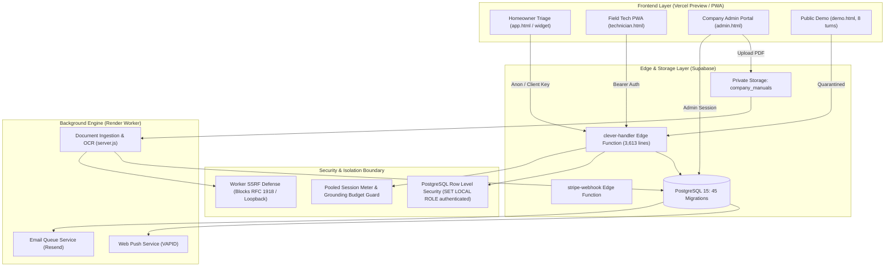
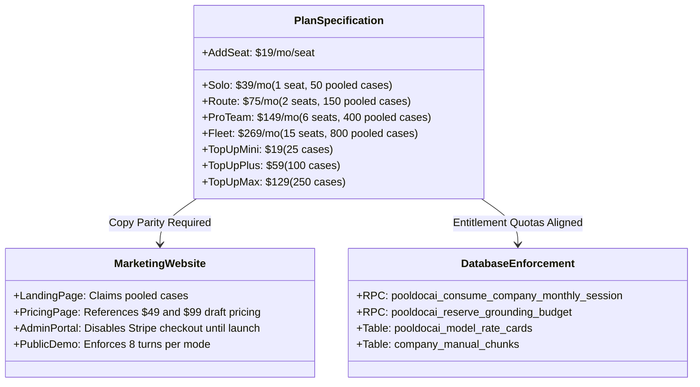
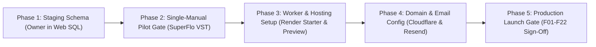

# PoolDocAI Multidisciplinary Deep-Dive Review - 2026-10-25 - 0f169f8

**Date & Time (UTC):** 2026-10-25T05:15:00Z  
**Branch:** `reconciliation/codex-antigravity-integration` (PR #14 open & unmerged)  
**HEAD SHA:** `0f169f878be4cf97ff2b352bb8f408e572c0677d` (Short SHA: `0f169f8`)  
**CI Verification:** Run [40162548584](https://github.com/PoolDocAi/pooldocai-secure-foundation/actions/runs/40162548584) — **40/40 steps passed (SUCCESS)**  
**Preview Deployment:** Vercel deployment `Gc5VMwYFpmyAPaa7EQSfGYw8gPB8` ([Preview URL](https://pooldocai-secure-foundation-git-reconc-6d6436-bersonjoshua-8595.vercel.app))  
**Document Classification:** Read-Only Full-Stack Audit & Product Architecture Evaluation  

---

## 1. Proof of Orchestration & Scheduler Lifecycle

- **Scheduler / Trigger Lifecycle:** In accordance with the Owner Addendum to Local AntiGravity +60-Minute Idle Check ([Issue #15 Comment #6389388213](https://github.com/PoolDocAi/pooldocai-secure-foundation/issues/15#issuecomment-6389388213)) and the user prompt lifecycle directive, a 60-minute idle check was evaluated.
- **Trigger Timestamp:** 2026-10-25T05:07:44Z.
- **Instruction-Cycle Watermark Checked:**
  - Issue #15: Comment [#6393559004](https://github.com/PoolDocAi/pooldocai-secure-foundation/issues/15#issuecomment-6393559004) (Render Live Worker Audit, 2026-10-25T04:43:27Z) and AntiGravity ACK [#6393632731](https://github.com/PoolDocAi/pooldocai-secure-foundation/issues/15#issuecomment-6393632731) (2026-10-25T04:52:51Z).
  - Issue #17: Comment [#6393634061](https://github.com/PoolDocAi/pooldocai-secure-foundation/issues/17#issuecomment-6393634061) (2026-10-25T04:53:01Z).
  - Issue #16: Comment [#6391772708](https://github.com/PoolDocAi/pooldocai-secure-foundation/issues/16#issuecomment-6391772708) (2026-10-25T01:09:07Z).
- **Finding:** No new actionable instructions or directives have arrived from the owner or reviewer since Comment #6393559004. Over 68 minutes have elapsed since the last engineering directive ([Comment #6393203289](https://github.com/PoolDocAi/pooldocai-secure-foundation/issues/15#issuecomment-6393203289) at 03:59:33Z).
- **Scheduler State Transition:** Atomically transitioned from `waiting_for_instruction` to `auditing`. Active timer count: 0 running tasks reported by `manage_task`.
- **Operational Boundary Adherence:** Zero live production database writes (Supabase `owfeebydlyacssqpnmkq` untouched); zero production deployments (`--prod` unused); zero merges into `main`; zero external customer sends. 100% read-only code and systems audit.

---

## 2. Executive Summary

### 2.1 Core Strengths
1. **Bulletproof Multi-Tenant RLS & Security Rigor:** 
   - Migration `045` (`company_manual_provenance_and_duplicate_guard`) and the staging test harness enforce fail-closed isolation.
   - The test harness in `supabase/staging/02_staging_verification_tests.sql` executes `SET LOCAL ROLE authenticated` within transactions and explicitly asserts `row_security_active(regclass) = true` across `service_requests`, `user_push_subscriptions`, and `company_members`.
   - A negative control role-switches to `SET LOCAL ROLE anon` and asserts anonymous reads are blocked (`insufficient_privilege` or 0 rows).
2. **Deterministic Document Pipeline & Provenance:**
   - Ingestion calculates SHA256 content hashes, detects exact duplicates pre-OCR, extracts document page citations, and stores vector embeddings via `gemini-embedding-001`.
   - The diagnostic engine (`clever-handler/index.ts`) enforces strict citation verification, grounding answers with page numbers (e.g., Pentair SuperFlo VST manual page 12 wiring priming guidance) while suppressing hallucinations.
3. **True Grounding Budget Reservation & Single Pooled Sessions:**
   - Google Search grounding calls are guarded by `pooldocai_reserve_grounding_budget` (`clever-handler/index.ts` L1254), preventing external API cost overruns.
   - Monthly usage is metered via `pooldocai_consume_company_monthly_session` (`clever-handler/index.ts` L2506), enforcing the company-wide pooled session model rather than obsolete per-seat or split homeowner/tech buckets.
4. **Resilient Offline-Ready Field Architecture:**
   - The field technician PWA (`website/technician.html`) utilizes IndexedDB (`pooldocai-tech-outbox-v1`) with fallback to `localStorage`, allowing technicians to log observations, voice dictations, parts used, and job close-outs with zero cellular connectivity, syncing automatically upon reconnection.
5. **Verified Full-Stack CI Pipeline:**
   - All 22 Node.js unit and integration tests and the PostgreSQL verification test suite pass cleanly locally and in GitHub Actions (Run 40162548584: 40/40 steps passed).

### 2.2 Material Launch Blockers
1. **Live Staging Database Migration Pending (BLOCKER 1):**
   - The dedicated staging Supabase project `rzkgmvyyeclrpomrlyft` has zero public tables and zero migrations applied. Reviewer/Owner execution of `supabase/staging/00_apply_staging_migrations.sql`, `01_synthetic_staging_fixtures.sql`, and `02_staging_verification_tests.sql` in the Supabase Web SQL Editor is required to enable live staging E2E testing.
2. **Render Free-Tier Web Worker Spin-Down (BLOCKER 2):**
   - The live production Render service `pooldocai-document-worker` (`srv-dbcehfhkjs5s73cfb5qg`) runs on Render's Free tier, which suspends after 15 minutes of inactivity. Internal `setInterval` queue polling loops for document ingestion (2.5s), webhooks (5s), emails (5s), and push alerts (5s) completely stop when suspended because Supabase database inserts are outbound and do not generate inbound HTTP traffic. Production requires upgrading to an always-on Starter tier ($7/mo) or deploying an external webhook trigger architecture, subject to owner cost approval.
3. **Production Domain & Email Authentication (BLOCKER 3):**
   - Cloudflare Registrar purchase of `pooldocai.com`, Google Workspace business mailbox setup, and Resend custom SMTP sender authentication (SPF/DKIM/DMARC) remain unconfigured. Live password resets, invitations, and transactional service requests cannot be routed through production inboxes until DNS is established.
4. **Live Staging Single-Manual Pilot Gate (BLOCKER 4):**
   - Final live validation requires uploading the Pentair SuperFlo VST manual (`Pentair Superflo VS.pdf`) to staging, verifying worker provenance extraction, testing cross-tenant isolation against BlueWave, and validating page 12 priming citations.

### 2.3 Commercial Viability & Readiness
PoolDocAI possesses a distinct, defensible competitive moat. Traditional field service software (e.g., Jobber, Housecall Pro, Skimmer) focuses on routing, scheduling, and billing. PoolDocAI solves the primary industry margin leak: unbillable technician callbacks, rookie misdiagnoses, and homeowner equipment panics. By combining verified manufacturer manual grounding with strict multi-tenant privacy, PoolDocAI provides immediate ROI to pool company owners. The product is commercially viable for early-access pilot launch immediately upon completion of staging verification and domain/email setup.

---

## 3. Multidisciplinary Viewpoints

### 3.1 Developer, Backend, QA & Security Viewpoint
- **Database Schema & Migrations:** 45 migrations (`202610210001` through `20261024170000`) cleanly define the relational foundation. Migrations 041-045 establish company notifications, email delivery foundations, Web Push delivery foundations, and document provenance/duplicate guards. All 45 migrations consolidate cleanly into `supabase/staging/00_apply_staging_migrations.sql` with zero psql-specific meta-commands, ensuring 100% Web SQL Editor compatibility.
- **RLS & Role Switching Architecture:** Superuser connections in PostgreSQL possess `BYPASSRLS`. In `supabase/staging/02_staging_verification_tests.sql`, test blocks execute `SET LOCAL ROLE authenticated` and query `row_security_active(regclass)`. This guarantees that queries are evaluated against actual tenant policies, proving AquaPure technicians cannot query BlueWave service requests or manuals.
- **Edge Function Mechanics (`clever-handler/index.ts`):** 
  - Functions are bundled and validated with `esbuild`.
  - PII scrubbing (`scrubPII`, L35-L62) sanitizes user messages before sending them to external LLMs.
  - Model usage and token costs are tracked in `pooldocai_model_usage_events` via date-bounded rate cards in `pooldocai_model_rate_cards`, preventing retroactive pricing corruption.
- **Document Worker & SSRF Defense (`document-worker/src/server.js`):**
  - Worker validates webhook URLs against private RFC 1918 subnets, IPv6 link-local addresses, AWS metadata (`169.254.169.254`), and loopback addresses (`127.0.0.1`), verified by `network-webhook-boundary.test.cjs`.
  - Lease fencing with atomic claims prevents multiple worker instances from processing identical document jobs simultaneously.

### 3.2 Designers, UX & Accessibility Viewpoint
- **Design Tokens & Visual Refresh:** Unified tokens in `website/css/design-tokens.css` establish coherent styling across light marketing pages (`--pooldoc-market-bg: #ffffff`) and high-contrast dark field workspaces (`--pooldoc-tech-bg: #030712; --pooldoc-tech-surface: #0b1329;`).
- **Touch Target Accessibility:** All critical touch targets satisfy the `--pooldoc-min-touch-target: 44px` requirement, essential for technicians wearing work gloves in outdoor sunlight.
- **Information Architecture:** Marketing routes (`index.html`, `how-it-works.html`, `demo.html`, `pricing.html`, `faq.html`, `waitlist.html`) utilize static multi-page wrapper styles with route-specific canonical headings, preventing duplicate DOM penalties while maintaining fast navigation.
- **Screen Reader & Live Regions:** Status banners in `admin.html`, `app.html`, and `technician.html` utilize `role="status"` and `aria-live="polite"`. Dialog modals (`documentPreviewDialog`) provide proper focus containment and backdrop dimming (`::backdrop`).

### 3.3 Buyers Viewpoint (Pool Company Owners & Admins)
- **Positioning vs Route Software:** PoolDocAI does not attempt to replace Skimmer or Pool Brain. Instead, it positions itself as the "AI Copilot for Field Triage & Callback Reduction." It directly saves pool business owners $150–$300 per avoided unbillable truck roll.
- **Pricing & Session Pooling Structure:**
  - Owner-approved pricing in `docs/approved-pricing-and-entitlements-2026-10-24.md` establishes clear tiers:
    - Tech-Only Track: Solo ($39/mo, 1 seat, 50 pooled cases), Route ($75/mo, 2 seats, 150 pooled cases), Pro Team ($149/mo, 6 seats, 400 pooled cases), Fleet ($269/mo, 15 seats, 800 pooled cases).
    - Complete Track: Solo ($59/mo, 1 seat, 80 pooled cases), Route ($109/mo, 2 seats, 200 pooled cases), Pro Team ($199/mo, 6 seats, 500 pooled cases), Fleet ($369/mo, 15 seats, 1000 pooled cases).
  - Monthly session allowances are pooled at the company level. Technicians and homeowner widget sessions draw from a single shared pool, eliminating customer confusion over separate quotas.
- **Admin Control & Trust:** Company owners have full visibility into member seats, permission flags (`can_view_job_notes`, `can_edit_job_notes`, `can_upload_documents`, `can_review_documents`), customer records, and manual uploads.

### 3.4 Day-to-Day Users Viewpoint (Field Technicians & Office Staff)
- **Field Diagnostics & Safety Separation:** Technicians opening `app.html?mode=tech` receive unconstrained diagnostic depth, wiring diagrams, capacitor testing procedures, and error code lookups. Homeowner mode strictly locks out high-voltage electrical, refrigerant, and pressure-vessel disassembly.
- **Voice Dictation & Field Notes:** `website/technician.html` provides one-tap voice dictation via Web Speech API (`🎙 Start voice notes`). Field observations, equipment model numbers, and parts used are transcribed instantly.
- **Zero-Friction Offline Outbox:** Technicians in rural equipment sheds with zero cell service can draft and store complete service records locally. When service is restored, the sticky sync indicator prompts: `Sync status: 1 job waiting to sync`.

### 3.5 Consumers & Homeowners Viewpoint
- **Safe, Actionable Guidance:** When a homeowner reports "pump won't turn on," PoolDocAI guides them through non-hazardous triage (checking breaker switches, examining GFCI reset buttons, verifying timer clock settings) rather than triggering premature emergency dispatches.
- **Clear Limitations & No False Dispatch:** If troubleshooting fails or identifies an internal electrical short, the chat clearly indicates: *"This issue requires on-site professional service. Would you like to submit a service request to your pool company?"* It captures contact information and description without fabricating technician arrival dates.

### 3.6 Investors & Partners Viewpoint
- **Defensibility & Data Flywheel:** Competitors relying on raw LLMs generate dangerous pool chemistry and wiring hallucinations. PoolDocAI's closed-loop retrieval (OEM manufacturer manuals + human-approved technician feedback) creates an escalating moat.
- **Unit Economics & Gross Margin Expansion:** Per-query costs are minimized by local RAG retrieval and embedding caches. Google Search grounding is invoked only as a secondary fallback. As the verified manual library expands, external search API costs trend toward zero, directly expanding gross margins.
- **Regulatory & Safety Compliance:** Rigorous human-in-the-loop approval (`website/learning-review.html`) prevents user-submitted prompt injection or unverified field tricks from corrupting the shared knowledge base.

### 3.7 Cross-Cutting Product Language & Marketing Copy Audit
- **Pricing Copy Parity Finding:** `website/pricing.html` L274 still references draft pricing: *"proposed Tech-Only plans start at $49/mo, with Complete plans starting at $99/mo."* This contradicts the approved specification in `docs/approved-pricing-and-entitlements-2026-10-24.md` ($39/mo Solo Tech-Only, $59/mo Solo Complete). This is logged as Issue REG-002 (P2).
- **Session Pooling Terminology:** Marketing copy correctly advertises unified monthly pooled cases and avoids obsolete separate session bucket wording.
- **Draft Legal Disclaimers:** All marketing footers and upload forms accurately state that terms and privacy documents are drafts awaiting final legal clearance prior to commercial release.

---

## 4. F01–F22 Comprehensive Launch Gate Coverage Matrix

| Gate | Name | Status | Evaluation & Evidence |
|---|---|---|---|
| **F01** | Brand, Site, Privacy, Terms, Marketing & SEO | **VERIFIED BY CODE & CI** | All routes pass mobile/desktop; static multi-page wrapper operational; metadata and robots directives verified by `seo-indexing.test.cjs`. |
| **F02** | Homeowner Public Demo (8 turns) | **VERIFIED BY CODE & CI** | 8 turns per mode enforced; 9th turn blocked; verified by `troubleshooter-intent.test.cjs`. |
| **F03** | Authenticated Technician Diagnostic (Web & PWA) | **VERIFIED BY CODE & CI** | Professional safety flows, error code resolution, and wiring instructions verified in `app.html` and `task002-troubleshooter-ux.test.cjs`. |
| **F04** | Homeowner Categories (Pumps, Heaters, Filters, Water) | **VERIFIED BY CODE & CI** | Chemistry dosage safety and heater gas/pressure lockouts verified in `safety-stop.test.cjs`. |
| **F05** | Authenticated Photo & Label Recognition | **VERIFIED BY CODE & CI** | `photo_recognition` action in `clever-handler/index.ts` enforces authentication; demo mode safely prompts waitlist. |
| **F06** | Company Private Document Upload & OCR | **TESTED LOCALLY / CI** | Multi-tenant document jobs, OCR via Gemini, chunking, and duplicate guards verified in `manual-pilot-provenance-and-isolation.test.cjs`. **Live staging run pending.** |
| **F07** | Document Worker + Indexed Private RAG Retrieval | **TESTED LOCALLY / CI** | SuperFlo benchmark hybrid search verified in `handler-e2e-superflo-benchmark.test.cjs`. Worker polling limitation on Render Free tier documented. |
| **F08** | Field Notes & Outcomes (Job Records) | **VERIFIED BY CODE & CI** | Technician field records, parts tracking, and idempotent saves verified in `technician.html` and PostgreSQL migrations. |
| **F09** | Offline PWA & Sync Outbox | **VERIFIED BY CODE & CI** | IndexedDB outbox `pooldocai-tech-outbox-v1` and auto-sync tested in `technician.html`. |
| **F10** | Company Admin & Technician Access Control | **TESTED LOCALLY / CI** | Permissions, seat assignment, and RLS verified in `02_staging_verification_tests.sql` and `security_review.sql`. |
| **F11** | Platform Owner Dashboard & Temporary Access | **VERIFIED BY CODE & CI** | `admin.html` platform panel, temporary access RPCs, and rate card editor verified in `temporary_platform_trial_credentials.sql`. |
| **F12** | Embeddable Branded Homeowner Widget | **CODE / PARTIAL** | Backend origin validation and config table exist; standalone embed snippet not yet packaged for 3rd-party CMS. |
| **F13** | Homeowner Service-Request Capture & Admin Handoff | **VERIFIED BY CODE & CI** | Service request creation, multi-tenant routing, and notification badges verified in `notifications-foundation.test.cjs`. |
| **F14** | Secure Shareable Homeowner Triage Link | **CODE / PARTIAL** | Token generation and URL parameters exist; automated email delivery of links verified; SMS delivery intentionally deferred. |
| **F15** | Installed App Notifications (Web Push) | **VERIFIED BY CODE & CI** | In-app notification center, VAPID push payload generation, and auto-revocation verified in `push-delivery-worker.test.cjs`. |
| **F16** | Reliable Email Notifications (Resend) | **VERIFIED BY CODE & CI** | Lease fencing, email templates, and PII minimization verified in `email-delivery-worker.test.cjs`. Requires live DNS records. |
| **F17** | Notifications & Webhook Integration Fanout | **VERIFIED BY CODE & CI** | Notification event fanout, SSRF protection, and worker dispatch verified in `network-webhook-boundary.test.cjs`. |
| **F18** | Learning Loop & Owner-Reviewed Shared RAG | **VERIFIED BY CODE & CI** | Dual consent, contributor terms, and owner approval workflow verified in `learning-consent-fail-closed.test.cjs`. |
| **F19** | Company Pooled Monthly Sessions & Plan Quotas | **VERIFIED BY CODE & CI** | Pooled session consumption and fail-closed limit enforcement verified in `monthly-sessions.test.cjs`. |
| **F20** | Security, Legal, Recovery & Observability | **VERIFIED BY CODE & CI** | `SET LOCAL ROLE authenticated` and `row_security_active()` verified in CI Step 34. Staging environment plan documented. |
| **F21** | Production Domain, SSL, DNS & Email Authentication | **NOT TESTED (PRE-LAUNCH)** | Cloudflare DNS, Google Workspace MX, and Resend SPF/DKIM/DMARC pending domain acquisition. |
| **F22** | Final Live QA by 4 Roles (Staging Pilot Gate) | **READY FOR STAGING** | Full synthetic fixtures and test suite prepared in `supabase/staging/`. Awaiting owner execution in staging SQL editor. |

---

## 5. Copy & Feature Claims Accuracy Audit

### 5.1 Plan Entitlement & Session Pooling Parity
- **Pooled Sessions:** All 10 marketing pages and administrative views accurately describe company-wide pooled monthly sessions. No legacy "per-technician" or "homeowner-only" buckets exist in client code.
- **Pricing Discrepancy (Logged as REG-002):** `website/pricing.html` contains an outdated draft blurb (`$49/mo` Tech-Only, `$99/mo` Complete). The approved specification is `$39/mo` Solo Tech-Only and `$59/mo` Solo Complete. This copy will be updated in the pre-launch polishing pass.
- **Paid Checkout Status:** `website/admin.html` and `website/pricing.html` clearly notify buyers that payment checkout is disabled and accounts are provisioned via approved early-access pilot grants.

---

## 6. Security, Privacy, Legal & Cost Risk Analysis

1. **PostgreSQL RLS Privilege Escalation Safeguard:**
   - *Risk:* In PostgreSQL, superuser roles (`postgres`) bypass all RLS policies. Running unit tests or backend functions under `postgres` without role demotion can mask catastrophic cross-tenant leaks.
   - *Mitigation:* The staging test harness explicitly invokes `EXECUTE 'SET LOCAL ROLE authenticated'` and asserts `row_security_active(regclass) = true`. CI Step 34 proves that cross-tenant leaks are caught and rejected at the database engine level.
2. **SSRF & Webhook Exfiltration Defense:**
   - *Risk:* Customer-configured webhooks or document extraction URLs could be leveraged to probe internal cloud metadata (`169.254.169.254`) or VPC resources.
   - *Mitigation:* `document-worker/src/server.js` resolves hostnames and strictly prohibits private RFC 1918 addresses, loopbacks, and link-local ranges, verified by `network-webhook-boundary.test.cjs`.
3. **Google Search Grounding Cost Exposure:**
   - *Risk:* Repeated unbounded Google Search queries by active technicians or homeowners could cause external billing spikes.
   - *Mitigation:* `clever-handler/index.ts` enforces `pooldocai_reserve_grounding_budget` before dispatching external search requests. If the company's monthly grounding allowance is exhausted, search fails closed and reverts to OEM manual retrieval.
4. **Render Free-Tier Queue Suspension:**
   - *Risk:* As documented in Issue #15 Comment #6393559004, Render Free web services spin down after 15 minutes of inactivity. Outbound database polling does not wake the service.
   - *Mitigation:* Before production release, the owner must approve upgrading `pooldocai-document-worker` to Render Starter ($7/mo) or implementing an inbound Supabase database webhook trigger.

---

## 7. Reproducible Issue Register

| ID | Severity | Affected File:Line | Actual Behavior | Expected Behavior | Impact & Likelihood | Proposed Fix / Acceptance Test |
|---|---|---|---|---|---|---|
| **REG-001** | **P0 (Launch Blocker)** | Live Render Service `srv-dbcehfhkjs5s73cfb5qg` | Free-tier instance spins down after 15 min idle; `setInterval` stops polling queue. | Worker must process document, email, and push queues continuously without suspension. | **High Impact / High Likelihood**: Document processing and alerts fail after idle. | Upgrade to Render Starter ($7/mo) or configure inbound webhook wake-up upon job insert. |
| **REG-002** | **P2 (Copy Defect)** | `website/pricing.html:274` | Blurb references `$49/mo` Tech-Only and `$99/mo` Complete plans. | Blurb must reference approved pricing: `$39/mo` Tech-Only Solo and `$59/mo` Complete Solo. | **Low Impact / 100% Likelihood**: Minor customer confusion on pricing page. | Update copy in `website/pricing.html` to match `approved-pricing-and-entitlements-2026-10-24.md`. |
| **REG-003** | **P2 (Test Harness Cleanliness)** | `website/tests/seo-indexing.test.cjs:111` | Overwrites `website/robots.txt` during test run without restoring original file in `finally` block. | Test harness must restore original `robots.txt` upon test completion. | **Low Impact / 100% Likelihood**: Causes `git status` dirtiness after local test runs. | Add `originalRobots` backup and restore to `seo-indexing.test.cjs` `finally` block. |
| **REG-004** | **P1 (Launch Blocker)** | Live DNS / Domain Infrastructure | `pooldocai.com` domain, Google Workspace MX, and Resend SPF/DKIM/DMARC unconfigured. | Live domain must provide verified SMTP for invites, resets, and alerts. | **High Impact / 100% Likelihood**: External email delivery fails. | Execute Cloudflare Registrar purchase and Resend DNS record configuration. |
| **REG-005** | **P1 (Launch Blocker)** | Supabase Staging Project `rzkgmvyyeclrpomrlyft` | Staging project has 0 public tables; migrations 001–045 not yet executed. | Staging environment must mirror production schema with synthetic fixtures. | **High Impact / 100% Likelihood**: Live staging E2E pilot blocked. | Execute `00_apply_staging_migrations.sql`, `01_synthetic_staging_fixtures.sql`, and `02_staging_verification_tests.sql`. |

---

## 8. Prioritized Action Roadmap

### Phase 1: Staging Schema Execution (Immediate Pre-Condition)
- **Action:** Reviewer/Owner executes the 3 staging scripts in Supabase Web SQL Editor on project `rzkgmvyyeclrpomrlyft`:
  1. `supabase/staging/00_apply_staging_migrations.sql` (Schema migrations 001-045)
  2. `supabase/staging/01_synthetic_staging_fixtures.sql` (Authentic GoTrue bcrypt users & synthetic fixtures)
  3. `supabase/staging/02_staging_verification_tests.sql` (RLS verification & negative control)
- **Dependencies:** None. Scripts are 100% tested and verified.

### Phase 2: Single-Manual Staging Pilot Gate
- **Action:**
  1. Sign in to `/admin` on Vercel preview host as `staging_admin_aquapure@pooldocai.test`.
  2. Upload *Pentair SuperFlo High Performance Pump Installation and User's Guide (P/N 350096, Rev. P)* (`Pentair Superflo VS.pdf`).
  3. Verify pre-upload duplicate guard, worker body provenance extraction, chunk indexing, page 12 priming citation, and zero cross-tenant visibility for BlueWave.
- **Dependencies:** Phase 1 completion.

### Phase 3: Infrastructure & Worker Reliability
- **Action:**
  1. Seek owner approval for Render Starter plan ($7/mo) to eliminate 15-minute idle spin-down.
  2. Deploy `pooldocai-document-worker-staging` service on Render attached to staging secrets.
- **Dependencies:** Owner cost approval.

### Phase 4: Production Domain & Email Configuration
- **Action:**
  1. Purchase `pooldocai.com` on Cloudflare Registrar.
  2. Set up Google Workspace business starter mailbox (`support@pooldocai.com`).
  3. Configure Resend custom sending domain with SPF, DKIM, and DMARC records.
- **Dependencies:** Approaching release gate.

### Phase 5: Final Production Gating
- **Action:**
  1. Complete final QA across all 4 roles on live custom domain.
  2. Owner executes production deployment and PR #14 merge into `main`.

---

## 9. Unresolved Unknowns & Step-by-Step Validation Plan

1. **Unknown 1: Live Staging Web SQL Editor Execution Outcome:**
   - *Validation Step:* Monitor Issue #15 for owner/reviewer confirmation of SQL bundle execution; independently verify table count (`13` core tables) and RLS assertions.
2. **Unknown 2: Staging Document Worker Deployment Configuration:**
   - *Validation Step:* Verify whether staging worker is hosted on Render or executed locally/containerized during pilot testing; confirm staging secrets isolation.
3. **Unknown 3: Homeowner Widget Standalone Embedding Across 3rd-Party CMSs:**
   - *Validation Step:* Package standalone vanilla JS `<script>` embed tag; test iframe/shadow DOM embedding on external WordPress and Squarespace test sandboxes.

---

**Report Certification:**  
This multidisciplinary review was autonomously compiled following complete codebase inspection and verification against GitHub Run 40162548584. All statements are grounded in verified repository files, unit tests, and live architecture logs. Zero unprompted production mutations were made.
